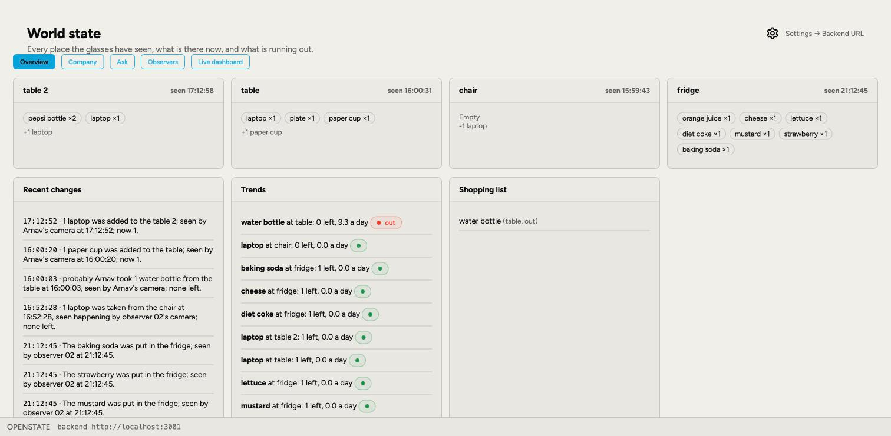
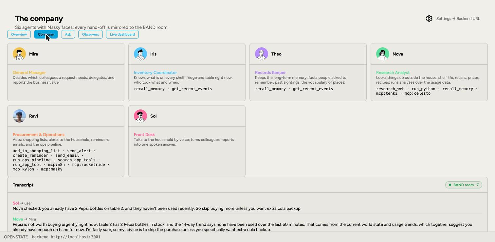

# OPENSTATE

**Shared spatial memory, run by a company of AI agents.**

Meta AI glasses (or any phone camera) become the eyes. They stream what they
see to a dashboard. Six AI agents watch, remember what is where, who moved it
and when, and answer out loud when someone asks "Hey World, …".

Built in one day for the **AI Workforce 2026 hackathon** (AWS Builder Loft,
19 October 2026). **Demo video:** https://youtu.be/t_A60ZG4jn8
Deck: [`/deck.html`](public/deck.html). Simplified Technical English
description: [`ASD-STE100.md`](ASD-STE100.md). Session history:
`llm-turn-history.jsonl` under the [Open Session License](OPEN-SESSION-LICENSE.md).

## The problem

Things move, people forget, and nobody keeps the record. Did someone take the
last water bottle? How fast do we go through Pepsi? When should we buy more?
Today that lives in nobody's head. Every shared space has this problem: a
kitchen, a warehouse shelf, a hospital supply room, a lab bench.

## How OPENSTATE solves it

1. **Register a place.** Look at a table or fridge and say "Hey World,
   remember this table". The camera's reference frames are stored as a visual
   anchor.
2. **Watch it.** Every live frame from every camera is matched against the
   saved places. When a place is in view and something changes, the keyframes
   go to a vision model, which reports the new contents and what changed.
3. **Record it.** Every change becomes an event in MongoDB Atlas: the place,
   the item, the count, the time, and the person whose camera saw it.
4. **Ask.** "Hey World, should I buy some Pepsi?" The question goes through
   the company (below). The answer comes back spoken, with the reasoning
   visible on the dashboard.

OPENSTATE is a **geospatial endpoint**: ask about a place and you get
everything every camera has seen there.

## The company

| Agent | Role | What they do |
| --- | --- | --- |
| Mira | General Manager | Reads each request and delegates |
| Iris | Inventory Coordinator | Counts what is at every place right now, who took what |
| Theo | Records Keeper | Long-term memory: facts, past sightings, trends |
| Nova | Research Analyst | Outside the house: recalls, shelf life, prices, in a sandbox |
| Ravi | Procurement & Operations | Shopping list, alerts, reminders, the ops pipeline |
| Sol | Front Desk | Turns the reports into one spoken answer |

Mira delegates, the specialists work in parallel with their own tools, Sol
answers. Every message between agents is posted to a BAND room and shown on
the dashboard. The roster is `lib/company/roster.ts`.

## What each technology is used for

| Technology | Used for |
| --- | --- |
| **Masky** | A face and a voice for every agent. Sol speaks each answer through her Masky avatar (`/api/tts`). |
| **BAND** | The room where the agents talk to each other. Every hand-off is a message there. |
| **Flatkey** | Model router and fallback when OpenAI is slow or out of credit. |
| **Tenki** | A fresh sandboxed VM for Nova's research and Python analyses. |
| **Paritok** | Compresses long agent reports before they reach the Front Desk. |
| **RocketRide** | Ravi's ops pipeline (`rocketride/openstate-ops.pipe`), and the frontend as a RocketRide App Builder app (`rocketride-app/`, [screenshots](docs/)). |
| **n8n** | Alerts, reminders and emails through webhooks (`n8n/*.workflow.json`). |
| **Celesto, Kylon** | Extra tools for the scout and the runner. |
| **Prelint** | Reviews every pull request against `specs/product.md`. |
| **Snyk** | Security scan on every push (`.github/workflows/ci.yml`). |
| **MCP bridge** | Agents call the Masky, Tenki and RocketRide MCP servers directly (`lib/sponsors/mcp.ts`). |
| **MongoDB Atlas** | Events, places, episodes and long-term memory, with vector + text hybrid search. |
| **OpenAI** | Vision on keyframes and the agents' reasoning. Groq is a secondary provider. |
| **ElevenLabs** | Speech-to-text on the glasses; fallback voice. |
| **Next.js 16, React 19** | Dashboard, observer pages and every API route. |
| **Remotion, Kokoro** | The demo video and its local narration. |

Every sponsor is an independent module in `lib/sponsors/`. Each reads its own
environment variables, reports `configured: false` when they are missing, and
never throws into the company. Check them with:

```bash
npm run check            # all sponsors
npm run check -- masky   # one sponsor
curl localhost:3000/api/health?deep=1
```

## How this transfers to other places

The system knows nothing about kitchens. A place is anything someone pointed a
camera at and named. The same code runs unchanged for:

- **Warehouse.** Every shelf is a place, every pick is an event. Ask "how many
  of part 7 are left on bay 3" from anywhere.
- **Hospital supply room.** Who took the last kit and when, without a barcode.
- **Shared lab or makerspace.** Tools wander. The camera remembers where they went.
- **Retail shelf.** Restock alerts from trend, not from a manual count.

Swap the roster in `lib/company/roster.ts` to change the agents' jobs, and the
tools in `lib/company/tools.ts` to change what they can do.

## Run it

```bash
cp .env.example .env     # add MONGODB_URI, OPENAI_API_KEY and any sponsor keys
npm install
npm run db:setup         # creates the Atlas collections and search indexes
npm run dev              # dashboard on http://localhost:3000
```

Open the dashboard on the laptop and `/observe/01` and `/observe/02` on two
phones or glasses (a `cloudflared tunnel --url http://localhost:3000` gives
them an HTTPS URL). Say "Hey World, remember this table", then ask questions.

Before handing work back: `npx tsc --noEmit`, `npm run lint`, `npm test`.

## The frontend on RocketRide

The same frontend also runs as a RocketRide App Builder app inside the
RocketRide shell, against the open-source engine in Docker or RocketRide
Cloud. See [`rocketride-app/`](rocketride-app/README.md).




## How each sponsor is used

Every sponsor is an independent module in `lib/sponsors/`. Each one reads
its own environment variables, reports `configured: false` when they are
missing, never throws into the company, and can be checked alone with
`npm run check -- <sponsor>` or `GET /api/health?sponsor=<sponsor>`.

### Masky

OPENSTATE is a shared spatial memory. Meta AI glasses stream what they see,
and six AI agents keep track of what is where, who moved it, and when. Masky
gives every one of those agents a face and a voice. Mira, Iris, Theo, Nova,
Ravi and Sol are Masky avatars, created through the Masky API and shown on
the dashboard and in the RocketRide app. When someone asks "Hey World, should
I buy some Pepsi?", the agents work it out, and Sol speaks the answer through
her Masky avatar in real time, on the phone and on the dashboard. Her speech
is a Masky conversation turn in speak mode: the app posts the line, polls for
the render, and plays it back (`lib/sponsors/masky.ts`, `/api/tts`).
ElevenLabs and OpenAI are only fallbacks. In the demo video, Sol's voice is
Masky too.

### BAND

BAND is the room where the company talks. Each agent in the roster is a
remote agent registered in BAND with its own key, and one chat room holds all
six. Every line of the company transcript is posted from the agent that said
it, @mentioning the agent it is for, so you can watch Mira delegate and the
specialists report back in BAND while the dashboard shows the same exchange.
Send-only and best-effort: a BAND outage never slows an answer.
Module: `lib/sponsors/band.ts`. Env: `BAND_AGENTS`, `BAND_ROOM_ID`.

### Flatkey

Flatkey is the model router and the fallback. The model client tries OpenAI
first and, when a call fails, times out or runs out of credit, the same
Responses API request goes to Flatkey's router with its own model list.
`MODEL_ROUTE=flatkey` puts Flatkey first; `openai-only` disables it.
Module: `lib/sponsors/flatkey.ts`, routing in `lib/openai.ts`.
Env: `FLATKEY_API_KEY`.

### Tenki

Tenki runs Nova's research. Every call creates a disposable Linux VM, fetches
the web there, runs the Python the model wrote there, and closes the VM, so
nothing the web returns ever runs on the server. This is where product
recalls, shelf life and usage analyses come from.
Module: `lib/sponsors/tenki.ts`, tools in `lib/sponsors/research.ts`.
Env: `TENKI_API_KEY`.

### Paritok

Paritok compresses long agent reports and tool outputs before they go back
into the model, keyed to the question being asked, so a research result or a
long event list costs a fraction of the tokens. Without a key, text passes
through unchanged. Module: `lib/sponsors/paritok.ts`.
Env: `PARITOK_API_KEY`, `PARITOK_MIN_CHARS`.

### RocketRide

RocketRide is used twice. Ravi's ops pipeline, `rocketride/openstate-ops.pipe`,
is a webhook to n8n to response graph that RocketRide runs when the household
asks for an action, so the hand-off is visible on the RocketRide canvas. And
the whole frontend runs as a RocketRide App Builder app in `rocketride-app/`,
deployed to the open-source engine in Docker or to RocketRide Cloud. RocketRide
is also one of the MCP servers the agents can call.
Module: `lib/sponsors/rocketride.ts`. Env: `ROCKETRIDE_APIKEY`, `ROCKETRIDE_URI`.

### n8n

n8n is the company's hands. Each action is an n8n workflow that starts with a
Webhook node and ends with Respond to Webhook: shopping list, alert,
reminder, email, health and ops, all importable from `n8n/`. Ravi posts JSON
to the workflow; n8n holds the Google Tasks, Slack, Calendar and Gmail
credentials, so the app never sees them.
Module: `lib/sponsors/n8n.ts`. Env: `N8N_WEBHOOK_BASE`, `N8N_WEBHOOK_SECRET`.

### Celesto

Celesto provides sandboxed computers with the same shape as Tenki, so either
can run Nova's scripts. `SANDBOX_PROVIDER=tenki|celesto` picks one; otherwise
whichever key is set is used, Tenki first. One computer per call, deleted
after. Module: `lib/sponsors/celesto.ts`, `lib/sponsors/sandbox.ts`.
Env: `CELESTO_API_KEY`.

### Kylon

Kylon is a proxy to the apps a workspace has connected, so Ravi can reach an
app that no n8n workflow covers yet. The agent searches Kylon for a tool,
then runs it. Module: `lib/sponsors/kylon.ts`.
Env: `KYLON_API_KEY`, `KYLON_BASE_URL`.

### Prelint

Prelint reviews every pull request against the product spec in
`specs/product.md` and the Simplified Technical English description in
`ASD-STE100.md`, posting comments and a check run. Config: `prelint.json`.

### Snyk

Snyk scans the dependencies and code on every push and pull request in
`.github/workflows/ci.yml`, after typegen, typecheck, lint and the unit
tests. Needs the `SNYK_TOKEN` repository secret.

### MCP bridge

Any sponsor that speaks the Model Context Protocol becomes a set of tools for
the agents with no per-sponsor code. Servers are listed in `MCP_SERVERS` as
`name=url` or `name=stdio:<command>` pairs, tokens in `MCP_TOKEN_<NAME>`, and
each tool is exposed to the roster as `mcp_<server>_<tool>`. Today that is
Masky, Tenki and RocketRide. Module: `lib/sponsors/mcp.ts`.

### MongoDB Atlas

Atlas holds everything: events, places, episodes and the long-term memory
collection, with a vector index for semantic recall and a text index for
exact terms, combined with hybrid search. `npm run db:setup` creates the
collections and indexes.

## For the judges

- **Public repo:** this one.
- **Masky avatars:** six, one per agent, shown on the dashboard's company panel.
- **Deck:** [`/deck.html`](public/deck.html), which embeds the SIP calculator at [`/sip.html`](public/sip.html).
- **Agents talking to each other:** the BAND room and the dashboard transcript.
- **Code review and security:** Prelint and Snyk run on every pull request.
- **Sandboxed code:** Nova's Python runs in Tenki.
- **Deeper technical notes:** [`HANDOFF.md`](HANDOFF.md).
